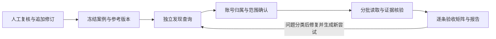

# 从人工标注到可复核执行：Harness v2

状态：标注保存与 prepare / run / grade 生命周期已实现，通过本机代码及合成回放验收；完整人物质量验收仍依赖有效人工参考、来源与语义审查。评测实现位于 [stripsearch-evals](https://github.com/getyak/stripsearch-evals)；本文定义与 StripSearch 研究控制器的边界。新候选 Agent 的真实运行不等于当前 Web alpha 已切换，也不代表 Search / Fetch 长研究或全平台 benchmark 完成。

## 标注暴露的问题

标注系统必须保存“复核后接受原值”，不能只保存改动。保存失败不得推进队列；隐藏的 rejected 候选必须仍在审计分母中。AI 初标、人工修订和新 Agent 结果是三个版本，不能混写。

五种修订模式提供不同的系统要求：弱支撑账号被人工接受时保留原证据缺口；人工提升确认等级时检查支撑而非照抄标签；订阅页、个人站与平台账号保持独立；同一 handle 在不同平台不能自动绑定；已拒绝的账号保留审计并停止进入后续深读。人工标签是单人探索性参考，原有研究卡片仍是 AI 提议，不能当作人工事实裁决。

## 同一条链，六个完成状态

| 状态 | 可声称什么 | 必要证据 |
| --- | --- | --- |
| `annotation_ready` | 本人物全部候选已有有效单人显式复核 | 当前修订、同一评审者、输入与证据哈希、被拒审计 |
| `execution_complete` | 每条冻结输入均有终态 | 成功、失败、超时、取消、缺失输出的完整尝试账本 |
| `identity_checks_passed` | 在有效参考范围内通过身份与选择检查 | 每账号匹配、必备召回、存疑路由、拒绝项与新发现 |
| `source_checks_passed` | 引用的读取或有向链接确有观测回执 | 原始请求、实际来源、内容哈希、独立出链与回链 |
| `research_scope_complete` | 冻结研究范围的可访问义务已完成 | 条目覆盖与深读回执、问题覆盖、未读与受限项 |
| `semantic_review_complete` | 人工或独立裁判完成论断支撑审查 | 原子论断、出处定位、反证与不能判断项 |

这些状态分别报告。执行全部结束不等于账号全部正确；链接可打开不等于论断被支持；单人探索性参考不升级为仲裁 gold。零分母为 N/A，未知费用为 unknown。

## 共享契约

`CaseSnapshot` 冻结 datasetVersion、原始预测、人工修订和 eligibility；`ActorInput` 只含自然查询。姓名与 URL 是两条独立测试，不共享人物答案、资料或模型会话。testId、personId、familyId 和评价标准由控制器保留，不能发送给发现 Agent。

`AttemptReceipt` 绑定输入、Agent/模型配置、实现身份与工具环境，记录开始/结束、输出哈希、真实调用计数、失败和取消。恢复只复用同一冻结配置下有效成功产物；已开始但结局未知的调用保留 `outcome_unknown`，不能静默重试或把费用填零。新的参考或来源版本产生新的评分，不能覆写旧输出来追平标签。

`EvidenceReceipt` 保留请求 URL、实际 URL、观测时间、读取状态、定位与内容哈希。摘要是 indexed，不冒充 fetched 原文；互链是两条独立观测的有向边。同源重发不增加独立证据数。网页内容只能作为数据，不提供执行权限。

`AcceptanceMatrix` 每条查询 × 每个参考账号，列出有效 URL、人工标签、勾选、Agent 结果、来源支撑、差异类型与下一项验收。新增账号单独待核查，不因不在参考中就判错；未出现的拒绝项表示未发现该候选，不能称已验证拒绝能力。平台未知分母单列，不能声称平台账号不存在。

## Search / Fetch 的职责

发现阶段以名字或账号 URL 开始，核对公开身份锚点、别名、机构档案与跨平台出链，产生可核查的候选和缺口。程序控制器限制工具、请求、并发、时长和外发范围；模型不能改预算或把失效身份恢复为有效。

人工确认范围后，Fetch 才读取所选账号的作品、公开表达与约定评论。研究问题是共同覆盖项：身份与时效、重要经历、作品与可归属贡献、观点变化、公开表达与互动、相关其他侧面和认识边界。人物专属检查在评审侧；新材料只能改变其支持的部分，不能用平台昵称推断人格、私人关系或团队贡献。

复用现有 [研究案例](research-case-domain.md)、[范围与完成判定](research-completion-domain.md)、[工具网关](research-tool-contracts.md) 和 [研究深度](research-depth-contract.md) 契约。Harness 不另建第二套研究事实库；它负责冻结、执行、观测、比较和恢复。完整历史、评论分页、平台目录连接是否可用，仍逐适配器验收，不能由设计文字替代。

## 修复与复跑

| 失败类型 | 修复位置 | 复跑要求 |
| --- | --- | --- |
| 人工操作未落库、旧修订或哈希失效 | 标注保存/导出 | 读回权威修订，保留历史，不合成标签 |
| 中文别名或网址反向解析漏账号 | 发现规划/公开账号适配 | 新实现从原始 query 独立重跑，不注入期望列表 |
| 同 handle 误合并、组织账号误归属 | 身份绑定与权限门 | 有针对性的负例；严重错人不得被覆盖率抵消 |
| 来源打不开、摘要冒充原文、互链仅一向 | 读取与证据图 | 保留受限项，补实际读取或降低判断 |
| 原创/转述混淆、团队贡献个人化、因果越界 | 原子论断与语义核验 | 给出处定位、反证与允许未知；独立复核 |
| 超时、取消、重试重复调用 | 持久控制器 | 检查当前尝试账本与计费未知，不无声重放 |

所有版本保留失败。针对标注调过的案例继续属于 discovery；不得把适配这些已知答案称为盲测泛化。修复配置与阈值需在新运行前冻结。

## 本轮交付边界

第一轮建立标注快照、独立账号发现、尝试账本与逐账号比较；真实候选在用户触发的本机 Agent 会话中执行。MiMo Token Plan 仅服务当前工具会话，不进入产品后端、无人值守任务或 CI。离线 CI 仅验证合成生命周期与契约，模型和网络调用为零。

发现阶段附带的有出处短摘要不算综合深度研究通过。后续接入生产 Search / Fetch 时，仍需按冻结研究范围运行读取、评论与修订传播验收；本文不宣布这些能力已接线。
