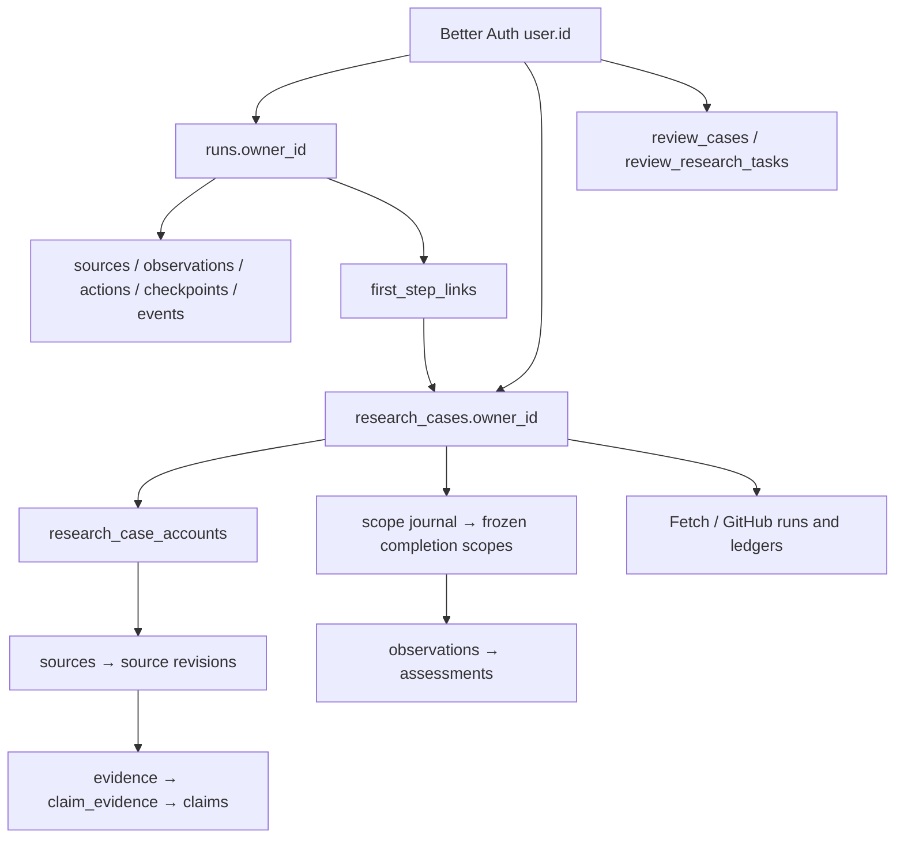

# 数据库与开发数据归属

源码核对基线：`5f895f2b0826b5e4ed1dd2c753886760eb2db472`（2026-11-07）。本文描述该版本的数据结构，不能据旧 checkout 推断当前服务或据空表宣称能力已验收。运行数据、绝对路径、账号、凭据及逐表快照保存在本机忽略目录。

## 存储边界

| 存储 | 作用 | 归属与限制 |
| --- | --- | --- |
| Web SQLite | 认证、研究、证据、标注工作台 | `STRIPSEARCH_DATA_DIR` 下的 `stripsearch.sqlite`；默认 `apps/web/.data`。`owner_id` 是 Better Auth 用户 ID，没有独立 workspace/tenant 表。 |
| Label Studio SQLite | 辅助身份标注 | 独立用户、组织、项目、任务和标注；不使用 Web 用户 ID。通过其支持的账号与成员管理共享项目，不改写历史标注人。 |
| promptfoo SQLite | 辅助评测配置、运行与结果 | 独立存储，不是 Web 的用户资料库。`evals.author` 不是 Web 外键；新运行同时记录实际操作者、逻辑测试归属和私有产物清单。 |
| 版本化文件 | 合成 fixture、平台目录、许可与离线评测契约 | `evals/`、`apps/web/data/platforms/`，保持共享和可复现；不搬进单个账号。 |
| 私有文件 | 研究正文、导入包、实际回执、辅助工具数据和凭据 | 忽略目录或部署方私有目录；按逻辑账号和任务记录来源、版本、内容哈希及资源依赖。 |

Web 是一个进程内的 Express + Better Auth + better-sqlite3 应用。Search / Discovery / Fetch 的数据在同一数据库中，但角色、范围与授权仍有各自边界。辅助标注与评测工具是独立系统；同邮箱不代表共享登录。历史预览、备份与已下线宿主的数据是独立档案，不能当作当前权威库自动导入。

## Web 的 55 张表

`apps/web/src/server/db/schema.ts` 定义 51 张核心表；Better Auth 在启动时通过 `getMigrations` 管理其余 4 张认证表。`db/index.ts` 开启 WAL、外键和 5 秒 busy timeout。业务外键主要保护子记录，根表的用户归属仍依赖应用校验。

| 领域 | 表 | 关键关系与不变量 |
| --- | --- | --- |
| 认证（4） | `user`、`session`、`account`、`verification` | `user.id` 是归属根；`session.userId`、`account.userId` 引用用户。`account` 是认证凭据，不是研究对象的平台账号。 |
| 旧研究运行（7） | `runs`、`sources`、`observations`、`run_events`、`research_checkpoints`、`research_actions`、`idempotency_keys` | `runs.owner_id` 隔离用户；来源/观察/事件/动作/检查点依赖 run。事件按 `(run_id, seq)` 唯一；动作按 `(run_id, action_key)` 唯一；幂等按 `(owner_id, key)` 唯一。 |
| 评审工作台（3） | `review_cases`、`review_annotations`、`review_research_tasks` | 案例内容哈希不可变；标注按 `(case_id, revision)` 追加。任务规范按 `(owner_id, dataset_version, external_id)` 幂等；规范不等于模型输出或人工标签。 |
| 旧平台发现（8） | `discovery_tasks`、`discovery_idempotency_keys`、`discovery_probes`、`account_links`、`account_link_revisions`、`tracked_posts`、`discovery_events`、`discovery_imports` | 任务 owner 控制访问；探测按 `(task_id, probe_key)` 去重，平台归属按 `(task_id, platform_id)` 唯一；归属撤回影响追踪帖子。 |
| 案例与证据（10） | `research_cases`、`research_case_scope_versions`、`research_case_accounts`、`research_case_sources`、`research_case_source_revisions`、`research_case_evidence`、`research_case_claims`、`research_case_claim_evidence`、`research_case_item_coverage`、`research_case_item_coverage_revisions` | case 是研究根；允许同平台多账号。来源修订、证据、论断和覆盖分开；证据与覆盖绑定 `(source_id, source_revision)`。作用域及覆盖修订保留历史。 |
| 完成判定（3） | `research_case_completion_scopes`、`research_case_completion_observations`、`research_case_completion_assessments` | 冻结范围按 `(case_id, scope_version)` 唯一；观测绑定义务与来源；判定存储输入哈希和政策版本，旧结果不可覆盖。 |
| 深读回执（1） | `research_case_fetch_receipts` | 绑定案例、账号和来源修订；读取状态、hash、定位与来源类型独立于生成的判断。 |
| Fetch 管线（8） | `research_fetch_pipeline_runs`、`research_fetch_pipeline_events`、`research_fetch_pipeline_checkpoints`、`research_fetch_pipeline_cursors`、`research_fetch_pipeline_originals`、`research_fetch_pipeline_findings`、`research_fetch_pipeline_intents`、`research_fetch_pipeline_requests` | 管线 run 绑定 owner/case/范围；保存请求意图、结果、原文、游标和 pending findings；未确认调用结局不得自动重放。 |
| GitHub 深读（6） | `research_fetch_github_runs`、`research_fetch_github_requests`、`research_fetch_github_listing_rows`、`research_fetch_github_items`、`research_fetch_github_comments`、`research_fetch_github_events` | 独立的分页、条目、评论和请求账本；不是认证 `account`，也不是旧 `tracked_posts` 的别名。 |
| 首步确认（5） | `first_step_links`、`first_step_discoveries`、`first_step_selections`、`first_step_exclusions`、`first_step_person_confirmations` | 连接旧 run 与新 case；发现、人物确认和账号选择保留各自修订。人物确认绑定输入、run 与 scope 版本，按 owner+幂等键去重并保留撤回状态；排除和选择共同限制后续读取范围。 |

箭头表示逻辑依赖，不保证每条都是数据库外键。`user` 与业务根的 owner 关系、部分 parent/retry/幂等关系必须通过应用与审计核对。

## 重点字段

| 实体 | 应重点核查的字段 | 原因 |
| --- | --- | --- |
| `runs` | `owner_id`、`parent_run_id`、`retry_of`、`revision`、`state`、`usage_json`、`cancel_requested` | 确保追问和重试不越权，取消后晚回包不继续写入，费用未知时不填零。 |
| `research_cases` / accounts | `owner_id`、`person_id`、`scope_version`、`identity_support_json`、`user_selection_json`、`allowed_scope_json` | 同名不是身份依据；用户选择与身份支持不同；同 case 子账号 owner 必须一致。 |
| 来源修订与证据 | `(source_id, revision)`、`content_hash`、`quote_hash`、`locator`、`revoked_at` | 旧证据不能重新绑定新正文；撤回不丢历史，也不能继续支撑现行结论。 |
| `review_annotations` | `owner_id`、`actor_id`、`actor_pseudonym`、`case_hash`、`revision`、`status` | 修改 owner 不等于修改真实评审人；人工判断不可由导入或模型补造。 |
| 完成判定 | `spec_hash`、`account_slice_hash`、`input_hash`、`scope_version`、`policy_version`、`evidence_revision` | “已完成”必须对应当时的输入、范围和有效证据，不能只按任务终态判断。 |
| `first_step_person_confirmations` | `owner_id`、`run_id`、`case_id`、`candidate_id`、`discovery_revision`、`input_revision`、`expected_run_revision`、`expected_scope_version`、`fingerprint`、`result_json`、`idempotency_key`、`revoked_at` | 确认结果必须对应当时的人物候选、输入和范围版本；按用户隔离幂等键，保留撤回记录。`case_id` 本身没有数据库外键，仍需应用层校验。 |

JSON 使用 TEXT 保存，由共享契约与 store 验证，不能只凭 SQLite 列类型判定语义有效。数据库级外键检查也不能替代 case/owner/范围一致性检查。

## 开发数据默认规则

1. 需长期保留的手工验收、演示、应用 E2E、练习载入、研究规范导入与新研究，默认使用开发者指定的测试账号。凭据从本机私密配置读取；账号不存在或登录失败应明确报告并停止对应写入，不随机换账号。
2. 登录后读回用户并解析稳定 ID；所有资源通过正常接口创建，写后核对归属。不要把邮箱直接写进 `owner_id`，不要使其他用户请求也落到测试账号。
3. Web 内合成练习通过 `POST /api/review/seed` 显式幂等创建；研究规范通过 `POST /api/review/research-tasks` 逐条导入，保留版本与哈希。读取列表不会自动初始化；载入规范也不会执行研究或生成标签。
4. Label Studio 为指定账号配置所需组织/项目权限；新标注保留实际操作者。promptfoo 新评测记录测试归属和私有清单；这不能证明其历史记录已有账号级访问隔离。
5. 临时 AI 验收若需要真实账号归属，先核对目标环境、账号与支持的隔离测试空间，验证 owner/target 对应，结束按流程清理。Web 目前没有子 workspace API，不能宣称已创建；单元夹具、迁移验证、跨账号与离线测试继续使用可销毁的合成环境。公共 fixture、平台规则与许可保留在 Git 中，私有原文与正式交付证据按测试账号/任务归档并排除 Git。

新注册密码范围为 6–128 字符，不要求大小写、数字或符号组合；6 位密码应能正常注册与登录。前后端共用 `LIMITS.passwordMin/passwordMax`，HTML 输入属性与提示同步。历史账号登录继续兼容已有密码，不因新注册的最小长度拒绝验证。凭据只用于明确的账号操作，不写入源码或日志。

## 历史数据与运行风险

- **不能只改一个 owner 字段。** `runs`、case、账号、首步选择、标注、动作、缓存和 JSON 依赖构成图。未来如确需迁移，先生成逐项清单、确认源账号与资源、一致备份，再按服务支持的导入方式处理；保留旧 ID 映射、真实作者、范围及修订。当前默认规则本身不迁移历史记录。
- **幂等悬挂引用可能是删除墓碑。** `Store.deleteRun` 删除研究，而 `idempotency_keys` 留存用于阻止相同请求键重建；原接口返回 410。不要把所有缺失 run 的幂等键都当垃圾删除。
- **核心 schema 无全局迁移版本账本。** 当前使用 `CREATE TABLE IF NOT EXISTS` 加 Better Auth 自有迁移；这不能自动升级同名表的列、约束或索引定义。未来非增量变更应显式版本化迁移并检查旧数据库兼容性。
- **账户删除缺少数据库级全图保证。** 业务 `owner_id` 未直接外键到 `user`；若后续提供销户，应在应用层事务处理相关业务数据和私有文件，保留必要审计并核对无越权残留。
- **SQLite 与文件都需要一致备份。** 活库不能直接 `cp` 后忽略 WAL；使用 SQLite backup 或服务管理器的停写备份，并保存对应 auth secret。共享原文、评测附件和辅助库需各自纳入恢复清单。
- **旧文档和空表不是能力证据。** 必须读回实际 `/release.json` 并检查当前 schema；Fetch 表存在甚至本地测试通过都不代表真人研究质量、provider live 行为或完整历史覆盖通过。

## 分析与验证入口

- 源码：`apps/web/src/server/db/{schema,index,migrate}.ts`、`auth.ts`、各领域 store、`routes/review.ts`、`routes/runs.ts` 和测试 harness。
- 只读审计：对已确认的当前数据库以 `mode=ro` 打开，启用 `query_only` 并在同一读事务中采样；检查 schema、索引、完整性、外键、用户存在性及 owner/case 一致性。输出不得包含密码、会话 token 或第三方正文。
- 设计检查：`python3 scripts/check_design.py`。这只验证设计材料；不等于数据库迁移、模型运行、真实 provider、发布或质量评测通过。
- 更改运行时后再按相关认证/授权/存储测试和发布契约验收；仅文档与只读分析不启动第二个 Web 实例或辅助服务。
