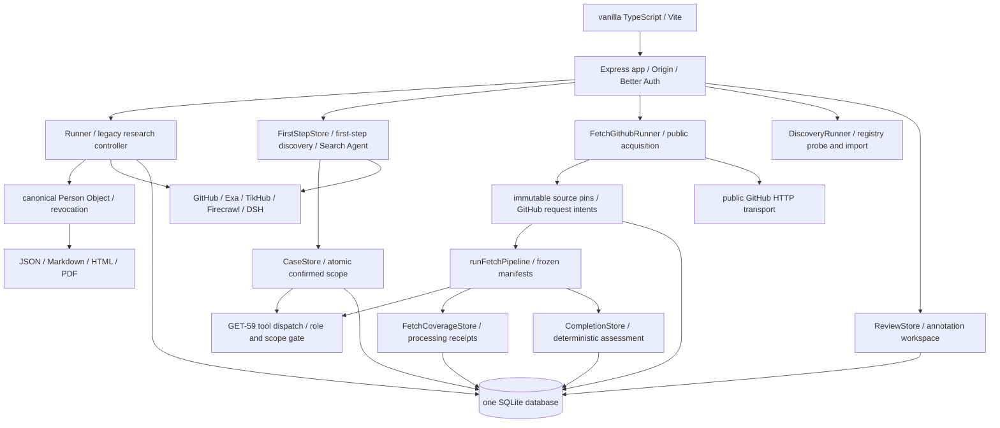

# 实现架构与风险地图（2026-10-13）

基线：`0017e11`，最新远端 main。本文件描述代码结构；[目标架构](../../architecture.md)与[路线验收](../../roadmap.md)继续有效。模块存在、测试可达、离线回放成功均不证明真实 provider、人物研究质量或发布已验收。

## 系统边界

## 模块地图

| 边界 | 入口与权威模块 | 责任与重要约束 |
|---|---|---|
| 进程组装 | `apps/web/src/server/index.ts`、`app.ts`、`config.ts` | 同一个 Web 进程组装所有 stores/runners；启动恢复未完成作业；关机中止 worker；loopback 与 hosted cookie 策略 |
| HTTP 与账号 | `server/auth.ts`、`server/http/*`、`server/routes/{runs,first-step,fetch,discovery,review}.ts` | 服务端 owner、Origin、请求体限额、revision/幂等检查；注册默认开放，allowlist 必须显式设置 |
| 数据库 | `server/db/{index,migrate,schema,row-helpers}.ts` | SQLite 增量迁移；事务一致性；业务 stores 持有状态规则，不由 renderer 决定 |
| 旧研究与报告 | `server/services/runner.ts`、`server/store.ts`、`server/research/{controller,research-store,planner,toolkit,metered}.ts` | 持久作业、预算预留/结算、取消与迟到包；canonical 报告与证据撤回，不等于完整新 Fetch 生命周期 |
| 第一步发现 | `shared/first-step-discovery.ts`、`server/research/{first-step-discovery,first-step-store,search-agent,identity-semantic-validity,link-context,alias-proof,named-owner}.ts` | 目录义务冻结、输入分类、身份原文约束、候选账号与一次原子范围确认；组织/作品归属不能直接变成人物事实 |
| 新研究领域 | `shared/{research-case,research-completion,research-fetch-coverage,research-fetch-pipeline,research-fetch-github}.ts`、`server/research/{case-store,completion-store,completion-eval}.ts` | 版本化账号/范围/来源/证据；撤回依赖；GET-60 assessment 是完成判断权威 |
| GitHub 采集 | `server/research/fetch-github-{acquisition,catalog,runner,store}.ts` | 固定公开目标、受限分页、精确全文与 hash、第三方评论作者分离；intent 未决必须显式调和，不盲重放 |
| 本地 Fetch 链 | `server/research/fetch-{pipeline,pipeline-plan,pipeline-store,pipeline-synthetic,coverage-store}.ts` | 注入式批次、持久不可变 manifest、分块、隔离核验、精确 checkpoint；finished 只指本地计划排空，研究 verdict 可仍为 partial |
| 工具授权 | `server/research/{research-tool-contracts,research-tool-dispatch,research-runtime,tool-contracts,dsh-decision}.ts` | 旧工具与 GET-59 分层；Fetch 10 / verify 3 工具矩阵；每次行动复验 scope/authority；模型不授予权限 |
| 平台目录与发现 | `server/platforms/*`、`server/discovery/*`、`server/{discovery-store,services/discovery-runner}.ts` | 版本化目录/公共规则、透明缺口、受限独立执行器；GET-92 规划器存在不代表接入真实请求链 |
| 采集基础 | `server/adapters/*`、`shared/{url-policy,response-primitives}.ts` | 注入 transport、超时/大小约束；各层 URL 策略及 provider facade 的语义差异保留，见代码维护契约 |
| 导出 | `shared/{canonical,report-html,research-depth,source-text}.ts`、`server/services/pdf.ts` | 同一 canonical 修订、事实与分析分离、转义与来源限制；PDF 另依赖 Chromium |
| 客户端 | `client/{main,api,auth,first-step,fetch,render,review,citation-return,local-search,home-motion}.ts` | 会话/运行世代竞态保护、确认范围、未知请求恢复、证据阅读与无障碍；不得把原始网页 HTML 当可信 UI |
| Eval | `src/evals/*`、`src/evals/research-baseline-v1/*`、`evals/*` | 冻结 provider/控制器回放、数据 schema、原创合成与未裁决标签；model quality 与 contract checks 分轨 |
| 发布与静态基线 | `deploy/*`、`.github/workflows/*`、`scripts/check_{design,eval_datasets}.py` | 容器合成烟测、typecheck/build/test、设计一致性；本机发布由单实例管理器负责，实际版本须读回 |

## 热点与测试边界

[可复现清单](architecture-inventory.json)由 `python3 scripts/architecture_inventory.py --output docs/sprints/2026-10-13/architecture-inventory.json` 生成。基线有 234 个 TS 文件、106 个生产模块、105 个测试文件。清单计数包括 type imports；测试可达是静态导入图，**不是行/分支覆盖率**。最近 40 次 first-parent 文件触达也不是故障率。

| 热点 | 基线行数 | 选择原因 | 本轮工作 |
|---|---:|---|---|
| `shared/first-step-discovery.ts` | 2152 | 38 处直接导入；身份/范围安全的共享权威 | B 增补语义与授权边界测试，D 合成 eval |
| `server/research/fetch-pipeline.ts` | 2245 | manifest/核验/恢复耦合，34 个测试文件静态可达 | B 挑选未覆盖的持久边界，既有回归集中执行 |
| `server/research/fetch-coverage-store.ts` | 986 | projection 内重复全表/数组查找，关系规模增长时成本上升 | C 局部行为保持重构与 before/after 基准 |
| `server/research/first-step-discovery.ts` | 2033 | 实际 Search 调用、授权与证据升级入口 | B 优先真实执行边界而非 mock 行为 |
| `client/main.ts` / `client/review.ts` | 1728 / 2638 | 入口 churn 高 / 标注页体积最大 | 记录后续拆分风险；本轮不同时改 UI 与存储 |

## 风险清单

以下是结构性风险和已记录缺项，尚未复现的项目不称作 bug。

| 优先级 | 风险与源码证据 | 影响 | 本轮行动 / 后续验收 |
|---|---|---|---|
| P1 | 身份发现共享模块巨大；原文、链接上下文、alias 与组织分类交叉 | 错人/错误授权或自述升级 | B/D 用反例钉住证据使用、否认、第三方关系和 scope drift |
| P1 | `fetch-pipeline.ts` 与 GitHub 持久采集跨多个事务及 phase manifest | 崩溃后的重复付费、漏材料或虚假完成 | 保留 intent/outcome 原子性、fail closed、未知调和和撤回回归；不缓存授权状态 |
| P1 | 文档明确缺少跨 worker lease/attempt fencing | 多实例可能重复执行或写入竞争 | 单实例限制继续有效；不因本轮重构宣称 GET-79 已实现 |
| P1 | 原文证据 / 评论作者 / sourceAccountId 是不同归属维度 | 第三方评论被错误归给主体 | 合成反例；精确 hash、角色与 source revision 不改变 |
| P1 | 离线成功与真人/外部 provider/部署验收存在边界 | 用户误信质量或实际可用性 | 每份 eval/release 明示 offline、unreviewed、未上线；原 README 线上地址与另一工作区退役草稿冲突需由实际部署记录裁决 |
| P2 | coverage projection 逐条与全量关系查找 | 大报告延迟与 SQLite 同步阻塞 | C 同样语料前后基准，保证撤回/历史顺序/作用域差异 |
| P1 已修复 | 旧测试harness继承部分provider key且默认transport可外发；ResearchPlanner替身不覆盖独立Search Agent | 离线测试触达外部API并产生不稳定等待 | 新增3例安全红绿回归；bootstrap前默认拒绝transport、清五类key；旧运行外发次数未记录 |
| P2 | URL 策略有意分层；toolkit 的 example 域仍由离线层禁网 | 错把输入验证当传输授权 | 禁网运行，保留策略差异；不触达 fixture URL |
| P2 | 多个 GitHub/Exa facade、canonical/hash 算法有意保留差异 | 泛化重构改变持久键或证据语义 | 限定 C 为投影局部索引，禁止调整 serializer/hash/provider 协议 |
| P2 | Node/Chromium/native SQLite 版本与环境耦合 | 编译或 PDF 验证不完整 | 复用锁文件一致的依赖；集中 build/test，明确 skip 与环境失败 |
| P2 | 本机资源检查 Node/swap 超诊断阈值 | 并行测试拖慢或耗尽空间 | 模型并行、重型检查串行；不终止他人任务、不新增常驻服务 |
| P2 | fixture 标签未人工裁决，blind holdout 尚无 | eval 分数被误报成研究准确率 | D 只发布确定性 contract 断言、失败计数与合成许可 |
| P3 | `docs/architecture.md` 保留目标架构“待实现”，README 兼有历史能力说明 | 新贡献者混淆设计/实现边界 | 本地图补足实际结构；E 用 git 事实与明确发布缺口撰写草稿 |

## 验证入口

- 静态：`python3 scripts/check_design.py`、`python3 scripts/check_eval_datasets.py`。
- 运行时：`npm --prefix apps/web run typecheck`、`npm --prefix apps/web run build`、`npm --prefix apps/web test`。
- 冻结回放：`npm --prefix apps/web run eval`、`npm --prefix apps/web run eval:research`。本轮新增 suite 与基准将在各工作流文档记录命令。
- 发布：离线/review/提交后才由 `deploy/local_service.py` 更新；实际 health/revision/assets/Notion 读回单独记账。本冲刺 PR 本身不声称生产已更新。
