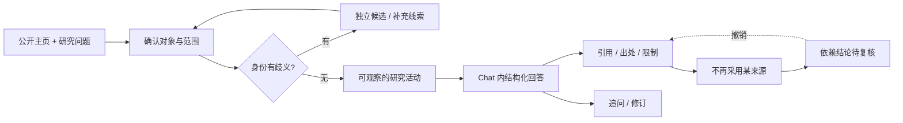

# StripSearch Web 设计

状态：当前视觉基线为 2026-10-21「循证阅读」细化 + 2026-10-23「来源平台阅读」增量（本页顶部两章）；2026-10-14 改版及其后各节保留为设计依据，能力边界仍以 [Web 运行时契约](web-runtime.md) 为准。本页不宣称未经测量的性能、转化或用户偏好优势。

## 当前细化：来源平台阅读（2026-10-23）

在 2026-10-21 基线上为既有 canonical 报告增加保守的来源平台阅读体验；只改呈现层，不新增事实、不改变来源、归属、撤回与引用返回契约。共享投影契约与验证边界见[来源平台阅读细化](design/platform-source-reading-2026-10-23.md)。

- 共享纯投影按链接主机保守匹配已知平台（GitHub、X、Bluesky、Threads、Reddit、YouTube、Bilibili、小红书、抖音、TikTok、Instagram、Facebook、知乎、微信公众平台），其余回退「网站」；混淆后缀主机与不安全 / 无法解析的链接安全回退，不生成可点击链接。平台标签只是展示标签，不是身份、能力或已读完证明；不编造作者、指标、缩略图、头像、媒体、认证或平台支持。
- 来源行显示安静的平台 / 域名 / 类型 / 时间 / 状态小字；来源详情补平台、域名、内容形态元数据与可见限制，摘录排版更强可读。只有 `fetchStatus: ok` 说「已取得材料」，且永远注明不代表全部历史已读完；视频等页面形态只按 URL 形状标注，媒体内容未读取。
- 出处面板顶部是基于本次运行真实来源的平台覆盖摘要：按平台的来源条数与已取得条数，与已选 / 已发现平台、当前筛选无关，未列平台不代表被搜索过。
- 历史预览把内嵌 URL 压缩为「主机 + 短路径」，URL 后的散文照常显示；完整问题保留在 `aria-label` 与 `title`。
- 无第三方网络、iframe、favicon 加载；沿用纸白 `#F3F1E9` / 森林绿 `#2D5241`、44px 触控目标、键盘可达、窄屏 / 深色 / 减少动效既有派生；来源分页与引用返回 / 焦点在重渲染与筛选后保持精确。全部离线验证，真实多平台线上验收归父级。

## 当前细化：同一份材料，逐步读深（2026-10-21）

面向带着姓名或公开主页来研究的人，首页先提供可提交的输入，再用同一份原创合成材料演示发现、原文与判断边界。沿用纸白 `#F3F1E9`、森林绿 `#2D5241` 和已有能力，不增加研究、付费或部署承诺。具体实现与验证见[本轮记录](design/evidence-reading-2026-10-21.md)。

- 宽屏首屏按 55:45 分配输入与材料；主标题两行同色，输入、示例、快捷键、提交和保存说明收在同一控件，聚焦时才强化边框。
- 林舟 / Lantern 的合成更新记录贯穿三步：首屏发现 → 打开原文 → 分清能说明、未知与解释。身份关系另列核查，不把项目互链升级为个人贡献。
- 绿色用于动作、选中和出处关系；普通章节以纸面、稳定间距和细分隔组织。仅首屏纸张有分层和接地阴影；出处括号作为品牌与引用共同细节。系统中文黑体承担标题和界面，宋体只承担原文。
- 引用按精确触发点记录阅读位置；打开原生 `details` 后可用“返回刚才的判断”或 Escape 回到该引用与滚动位置。鼠标与键盘焦点均可显示同组判断和来源关系。无 JavaScript 时原文仍能由原生披露打开。
- 入场只编排首屏输入、纸张和出处；后续正文稳定。纸缘光影只在首页，允许暂停，并随隐藏页面、离开首页和减少动效设置停止；不引入滚动劫持或研究假进度。
- 当前自托管版本为价格区主角；个人 / 团队订阅合并为简短筹备说明，保留未开放、定价待公布与模型/API/服务器另计的边界。
- 验收使用离线检查与原创合成浏览器状态，覆盖窄屏、深色、长输入、焦点、引用返回、无 JS 和减少动效；不调用外部研究服务，不宣称真实用户偏好、付费效果或线上发布。

## 当前基线：证据阅览室（2026-10-14）

以下保留 2026-10-14 基线与当时验收结果；本轮改动以上方 2026-10-21 契约和对应验证记录为准。

设计依据：[体验设计](design/experience-2026-10-14.md) · [实施计划](superpowers/plans/2026-10-14-evidence-reading.md)。[A/B 概念原型](../design/explorations/evidence-reading-2026-10-14/index.html)（A 证据阅览室胜出、B 线索标本台保留）是独立合成原型，不是运行产品。改版只重组现有 Web alpha 的呈现层：路由、导航名称、表单 ID、认证与注册默认策略、API 契约、canonical 事实与不确定性语义全部保持不变。

### 视觉系统

纸面 / 墨色 / 安静绿的编辑式体系，中等密度（营销面 4/10，工作台 7/10），无新依赖、无远程字体。

| 角色 | 浅色 | 深色 |
| --- | --- | --- |
| 环境 | 暖纸 `#F3F1E9` | 墨绿 `#151D19` |
| 阅读面 | `#FFFEF8` | `#1C2721` |
| 次级面 | `#E8EDE2` | `#25332B` |
| 正文 | `#243A31` | `#E7EDE5` |
| 辅助正文 | `#58675E` | `#B4C2B7` |
| 操作 | `#2D5241`，白字 | `#A9CFB3`，深墨字 `#14261B` |
| 未知 | 琥珀 `#856226` | `#D9AE5F` |

对比度已按 WCAG 相对亮度公式测量（本轮实际计算）：浅色下正文/纸面 12.05、辅助正文/环境 5.28（小字与占位文字同值，对次级面 5.02）、操作白字/操作底 8.77、未知琥珀/纸面 5.51、未知琥珀/次级面 4.68；深色下正文/阅读面 12.96、辅助正文/次级面 7.15、操作深墨字/操作底 9.27、未知琥珀/次级面 6.41。控件边框取 `#7A8879`（浅）/`#6B7F70`（深），对承载面 ≥3:1。测量只覆盖这些静态配对，不代表完整可访问性审计。

字体：系统中文 sans 用于界面与标题；宋体/serif 仅用于首页原文引用（对照区引文）。主标题桌面约 62px、手机 34–38px；正文 15–17px；元数据不低于 12px。形状：操作 8px、输入/对话框 12–16px、材料页 6px；只有主材料物带分层纸张与接地阴影。品牌文字、导航名称（产品 / 研究方法 / 价格）与锚点（`#example` / `#boundaries` / `#pricing`）保留。

### 官网结构（D2-A1）

首屏真实输入与证据物并置：左侧是可提交的研究表单（`#research-form`，示例填入不发请求）；右侧是原创合成的 Lantern 更新材料，有材料支持的语句、来源与日期（Lantern 更新记录 · 2025 年 6 月）和显式未知（还不能证明）同框。后续三段各用不同布局族，不再是左文右卡重复：

1. **身份**：横向关系轨道（种子线索 → 互链线索 → 同名候选待确认），同名不合并、待确认有文字标签。
2. **证据阅读**：宽幅结论/来源对照，serif 引文与「能说明 / 还不能说明 / 可能的解释」分列。
3. **方法**：居中陈述加三列短注；**版本与费用边界**保留未收费声明（尚未开放订阅或收款、模型/API/服务器费用另计）；**FAQ** 保留诚实边界问答。

识别交互为「引用连接原文」：点击 `出处 [S1]` 就地打开对应材料（原生 `details`），焦点移到披露行，200ms 颜色/透明度强调；不监听滚动、不搬移 DOM，显式点击时允许浏览器将焦点位置带入视口。无 JavaScript 或减少动效时全部内容仍可读（材料内容静态存在，`details` 原生可开）。旧三阶段滚动叙事（[历史契约](home-scroll-design.md)）已由静态组合取代，`createHomeMotion` 接口保留，只做引用揭示与生命周期清理，不发请求、不用计时器。

### 工作台与各功能面

工作台保持独立的高密度功能阅读桌：历史栏、主阅读区、按需出处面板分层；报告长文本、引用、来源排除、恢复与受影响结论语义不变。人物与账号确认保留单选人物、明确账号选择、草稿、冲突与固定提交区（`#first-step-actions`），选中/待确认/被排除均有文字标签。登录为系统 native dialog，标签、错误、可见焦点、Escape 与焦点返回齐全。Fetch 与标注沿用同一环境/表单/列表/空状态语言；授权勾选、真实请求状态、缺口、待核与评审语义不因样式改变。

### 动效与可访问性

品牌动作只有引用揭示（200ms 颜色/透明度）；按钮、输入反馈 120–180ms；无循环装饰、无滚动劫持、无假进度。`prefers-reduced-motion` 下反馈即时完成且内容不丢失；控制器生命周期移除监听。触控目标 44px、可见焦点、状态不只靠颜色；浅深主题同 token 派生。动效与对比检查属自动与静态检查，不构成用户研究结论。

### 本基线的验证边界

2026-10-15 本地验证：`typecheck`、客户端/服务端构建、全套离线测试与 `python3 scripts/check_design.py` 通过；对比度为上表实测值。浏览器已复核 320/390/850/1440px、浅深主题、减少动效与关键交互，证据与实测位置见[验收记录](design/experience-2026-10-14.md)。未做：真实用户偏好实验、性能 trace、外部 provider 与公网生产验收。因此不宣布优于任何竞品或旧版；[A/B 原型](../design/explorations/evidence-reading-2026-10-14/index.html)与旧设计保留，可回退比较。

## 历史设计（保留为依据）

以下记录 2026-09 至 2026-10 上旬的设计决定，不再代表当前实现的视觉基线。

### 访问者与入口

访问者正在准备采访、理解作者的作品，已有一个公开主页，但不确定材料是否属于同一个人、观点是否有实际行动支持。首页需要让其理解：这里既能提出研究问题，也能逐条复核回答依据。

核心承诺沿用产品设计：**理解一个人，沿着证据走。** 感受应是精确、可控、有探索欲；下一步是输入公开主页与问题，或打开合成示例。

“持续归属核查、反证和撤回”是待验证的产品差异，不宣称已优于竞品。原型中的运行状态、报告与来源均为合成演示。

### 两个视觉方向（2026-09-21，历史）

| 维度 | A · Evidence Terminal | B · Research Observatory |
|---|---|---|
| 主张 | 每一项判断都可以沿证据回溯 | 在时间与上下文中阅读一个人的公开工作 |
| 比喻 | 研究终端，逐步连接问题与证据 | 研究档案，逐页揭示事件与材料 |
| 空间 | 非对称网格、宽输入、编号来源 | 目录边栏、编辑式阅读区、时间切片 |
| 优先内容 | 提问、研究活动、可点击引用 | 研究对象、档案目录、历史变化 |
| 识别交互 | 点击结论引用，出处定位随之展开 | 沿时间选择事件，同时显示同期材料 |
| 避免 | 黑客电影、打字雨、监控大屏、伪终端日志 | 新闻门户、静态 PDF、普通博客 |

已在 Open Design 生成并实际查看 A/B 的桌面首屏、研究内容与 390px 手机折叠。选择 A，保留 B；不把配色变体算作两个方向。选择依据是研究入口可见性、证据关系与用户指定风格，属于设计判断，不是用户研究结论。

原稿：[A · Evidence Terminal](../design/web/concept-a.html) · [B · Research Observatory](../design/web/concept-b.html)。历史视觉规范见[设计规范](../design/web/DESIGN.md)与[验证记录](../design/web/VALIDATION.md)；[Signal Atlas / Open Dossier 探索](../design/web/next/README.md)与[多平台状态契约](../design/web/NEXT-DESIGN.md)同为历史素材。

### 首页：连续研究桌（2026-10-06，已被 2026-10-14 静态组合取代）

历史首页采用[三阶段滚动叙事契约](home-scroll-design.md)：真实输入 → 身份关系 → 证据与理解，合成工作区随阅读展开。该滚动叙事与面板 DOM 搬移已由上文静态证据组合取代；本节保留为历史依据，其合成内容边界与订阅区诚实声明仍有效。

### Chat 信息结构

桌面：研究列表 / 对话与结构化回答 / 可收起的出处检查器。中列为主，出处侧栏只在核查时占空间。

移动：单列对话，历史与出处作为独立抽屉；关闭返回触发控件。输入区不覆盖末尾回答，长报告不横向滚动。

研究活动展示读取、核对等可观察步骤与结果，不展示隐式推理；合成演示不会伪装真实工具日志。

## 内容与状态契约

| 对象 | 必须可见 | 不能表达成 |
|---|---|---|
| 身份 | 种子主页、独立候选、归属依据、未确认项 | 同名自动合并 |
| 来源 | 类型、日期、原文、位置、能说明什么、还不能说明什么、状态 | 搜索摘要等于已读正文 |
| 结论 | 支持证据、推断标识、反证与限制 | 人格分或无依据可信度百分比 |
| 运行 | 范围、阶段、暂停/失败/部分结果、真实步骤进度 | 无限假进度或演示等于上线 |
| 撤回 | 被排除来源、受影响结论、就地撤销入口、导出状态 | UI 撤下但报告继续可靠 |
| 追问 | 脚本支持范围与可用预设 | 固定答案冒充理解任意输入 |

工作状态只用中文，并按实际状态派生：`等待确认` / `正在查看资料` / `已暂停` / `已完成` / `N 处待复核`。不出现 `RUNNING`、`COMPLETE`、`LOCAL` 之类内部代码。

状态覆盖：初始空白、输入错误、候选待选、研究活动、停止与继续、失败与重试、有限结果、来源无法访问、无匹配筛选、不再采用来源、追问与新建。

原型不接受真实本地档案，不读取示例域名，不调用供应商或模型。下载与复制都为本地合成 Markdown。正式 Web 应读取同一 canonical report，不能另写一套报告事实。

## 报告与导出

- 报告标题固定为 `这个人是谁` / `做过什么` / `查到的事实` / `可能的解释` / `还不确定`，保留出处引用、本人自述标识以及事实、推断、未知的分列。
- 报告正文删去重复定义，只删冗余表述，不改事实、来源与依赖关系。
- `下载报告` 用本地 Blob 生成同一份 Markdown；`复制报告` 使用 `navigator.clipboard.writeText(buildMarkdown())`，只在报告就绪时可用。
- 复制成功才提示已复制；被浏览器阻断或失败时提示改用 `下载报告`，不谎报成功。
- 导出提示使用独立状态区域，不覆盖研究生命周期状态。

## 来源排除与撤销

- 当前固定夹具只允许排除 S2；主操作文案为 `不采用这条来源`，排除后为 `恢复来源`。
- 排除会同步更新所有依赖它的展示语句、已有回答与导出标记，并在出处面板就地显示 `N 处结论待复核` 与 `撤销`。
- 撤销入口在桌面检查器与移动抽屉内都可用；抽屉打开时背景 `inert` 并保持键盘焦点陷阱。
- 新建研究或重置会清空撤销状态，旧操作不会作用到新报告。
- 选中的来源始终有清晰选中态；原型不伪造打开远程示例 URL。

## 动效与可访问性（历史规范，约束仍适用）

旧版使用 HUD 模板语言（黑底、荧光绿），已被当前纸面体系取代。动效约束沿用：动效只服务真实状态，输入聚焦高亮、引用选中 150–240ms、进入过渡 150–240ms、进度条由已完成步骤数驱动并带 `role="progressbar"` 与 `aria-valuenow` / `aria-valuetext`；无无限装饰动画、假打字机或人为延迟；`prefers-reduced-motion` 在偏好变化时生效，状态仍会更新。触控目标不小于 44×44px；主控制有可访问名称与键盘焦点；错误就地显示并移动焦点；状态不只依赖颜色；桌面导航保持单行。

## 调研来源与采用机制

查阅日期：2026-09-20 与 2026-10-14。

- [Linear UI 设计回顾](https://linear.app/now/how-we-redesigned-the-linear-ui)：采用导航、内容与属性面板的层级分工；不复制视觉身份。
- [Exa 官方网站](https://exa.ai)：参考明确的研究工具入口与结构化内容示例；不移植其规模或性能指标。
- [Resend 官方网站](https://resend.com)：参考精练开发者产品定位与直接展示实际界面的表达；不复制其品牌图形。
- 2026-10-14（见[体验设计](design/experience-2026-10-14.md)）：Ambi 的材质/排版一致性观察、Are.na 的材料优先与来源表达、Cosmos 的安静环境主次；均不复用图像、字体或品牌，Ambi 本轮抓取超时、旧观察未称 live 验证。
- Open Design 内置 HUD 与 Mission Control 模板：历史素材。

## 验收与后续实现边界

设计验收看真实渲染：桌面与窄屏、首页到 Chat、候选确认、引用检查、失败恢复、复制与下载、来源排除与撤销、键盘关闭抽屉。视觉判断与功能检查分别记录。

正式开发应先稳定报告和作业状态契约，再确定 API、流式事件、持久化与权限。原型里的计时器、合成来源和预设回答不进入真实研究链路。
