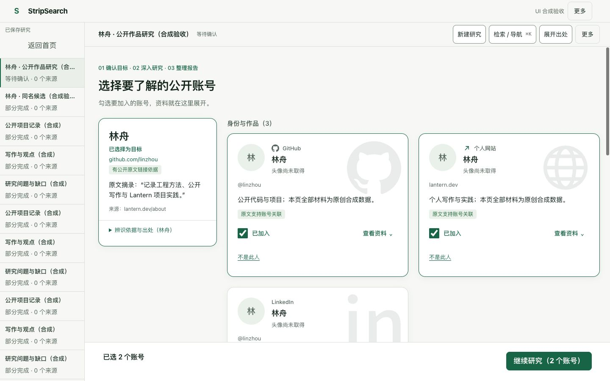
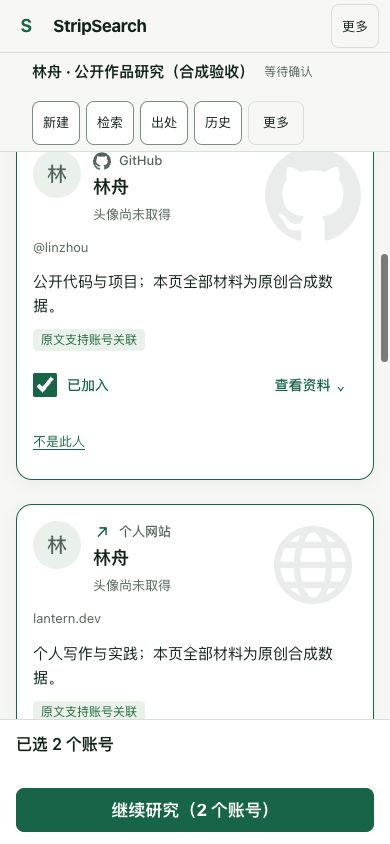

# 人物与账号确认工作区

将 Figma [账号选择组件 251:4082](https://www.figma.com/design/0mWx06dWHOz0gCPjjAgcPp/StripSearch?node-id=251-4082) 适配到现有研究工作区：紧凑顶栏与历史栏、人物候选卡、桌面双列账号卡、卡片内出处和常驻确认栏。保留纸白/绿色、16px 圆角、平台标识与淡水印；手机使用单列，平板缩小人物占位。

## 行为边界

- 先确认人物，再勾选账号；同名候选保持独立。选择、出处展开、不是此人和仅研究独立账号各自执行原有动作。
- 计数与提交按钮放在滚动内容之外，切换研究或退出确认时清空。刷新保留草稿；新账号不自动加入。
- 用户选择不会升级身份可信度，未确认、反证、范围限制与出处继续显示。提交载荷和服务端研究流程没有变化。
- 没有可信头像字段时显示单字占位与“头像尚未取得”。没有复制设计稿人物照片或简介，没有新增抓取、模型或付费 API 调用。

## 验证（2026-10-12）

- TypeScript 检查、生产构建、设计检查通过；独立 review 的焦点裁切 P2 已修复并复核，没有未解决的 P0/P1/P2。
- 浏览器使用实际生产前端构建、原创合成资料和本机内存存储。1440×900、900×900、390×844、320×740 无横向溢出；确认栏保持可见。检查暗色、减少动画、键盘焦点和手机历史弹窗 Escape 返回焦点。
- 六个账号的 64 种勾选组合，计数与按钮启用条件全部通过；展开出处不改选择，刷新保留选择，切换研究不带入其他草稿。
- 同名候选的独立账号提交经过实际选择校验与存储，身份仍未确认；提交后确认栏清空、对话栏恢复。此验收没有执行真实研究，不代表研究质量或外部 provider 已验证。

以下截图仅含原创合成数据：

